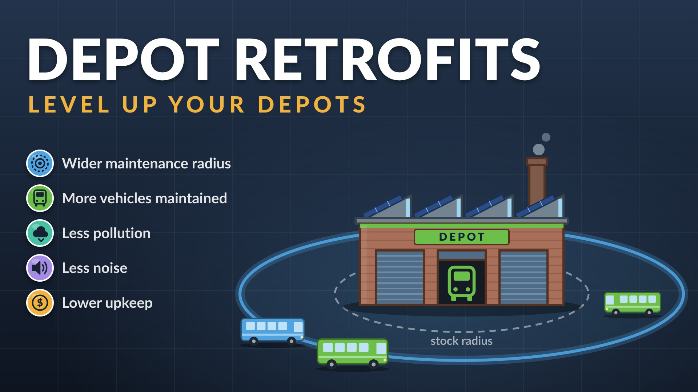
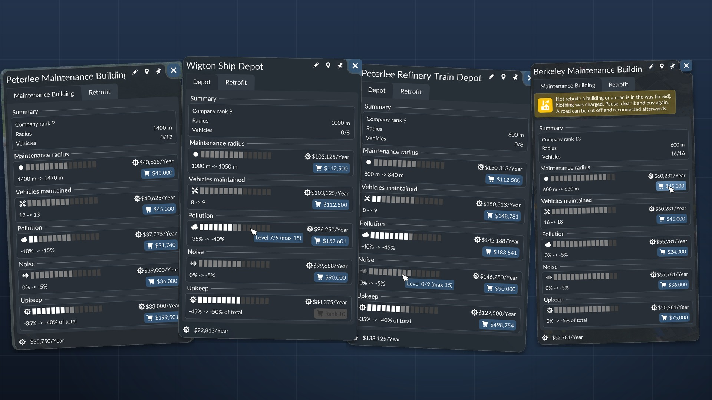

# Depot Retrofits

A Transport Fever 3 script mod: depots and maintenance buildings get levels that widen their maintenance radius, raise the number of vehicles they maintain, cut their pollution and noise, and cut their upkeep.

**Get it:** [Depot Retrofits on mod.io](https://mod.io/g/transportfever3/m/depot-retrofits) (mod id 6495416). Subscribe there or in the game's Mod Hub (search for "Depot Retrofits"), then activate it under Mods in New Game or Load Game.

  
  

## In short

- **Status.** Version 1.1.1 (1.0 was the first release; 1.1 adds a "Blocked" warning, 1.1.1 fixes it on some road depots). The mod stores, applies and sells levels in a Retrofit tab in each depot's and maintenance building's window: one card per retrofit, with a row of 15 boxes for the levels and a buy button. The repo also holds the spec and the verified game facts.
- **How it works.** The mod wraps each depot construction's update script and reads hidden level parameters from the construction. Buying a level rebuilds the construction with the new level, and the wrapper scales the pool, the radius, the emissions and the upkeep. The game has no command that changes these values on a standing building, so a rebuild is the only route.
- **How sure.** The game facts are read from the game's own scripts. Another published mod uses the same rebuild method for industries.
- **Tested.** In game, a rebuild keeps the building and its vehicles' lines and applies all five values. Levels given to 18 buildings matched the formulas for a game month, and buying a level in the Retrofit tab charged the shown price and applied it, up to the company rank. The catch: every rebuild unlinks the vehicles the building maintains, and the game reassigns them within a day, not always to the same building. See [docs/design/findings.md](docs/design/findings.md).

## Notes

- [docs/user-guide.md](docs/user-guide.md): how to buy levels, what they do and what they cost.
- [docs/design/spec.md](docs/design/spec.md): the five retrofits, prices, upkeep and rank gate.
- [docs/design/findings.md](docs/design/findings.md): what is verified about depots in the base game and what a mod can change, with source files.
- [docs/publishing.md](docs/publishing.md): how a version is uploaded to mod.io and released.
- [CHANGELOG.md](CHANGELOG.md): what each version changed.
- [TODO.md](TODO.md): what is left to do.

## Licence

MIT, see [LICENSE](LICENSE).
