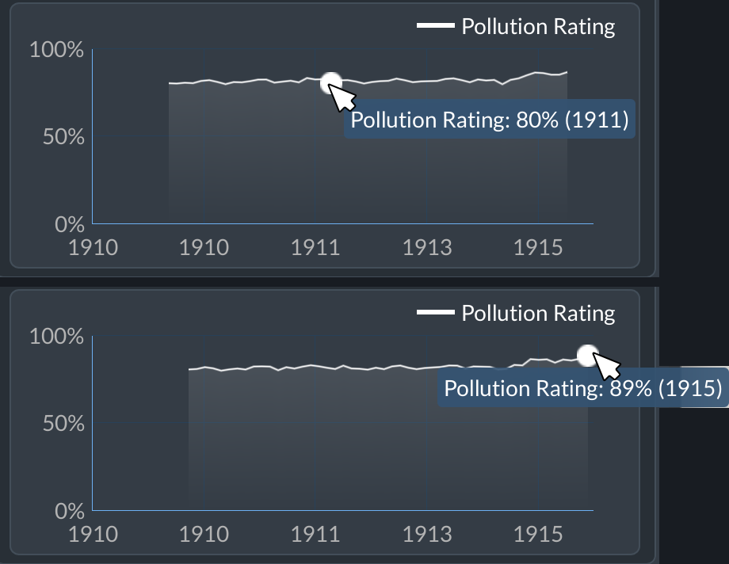

# User guide

## In short

- **What it does.** Depots and maintenance buildings get levels. A level widens the maintenance radius, raises the number of vehicles maintained, or cuts pollution, noise or upkeep.
- **Where to buy.** Open the building's window and choose the Retrofit tab. Each level is bought on its own, for money.
- **What it costs.** Each level costs more than the one before. Every level except the upkeep levels also raises the building's upkeep.
- **Limit.** A retrofit's highest level is your company rank.
- **One catch.** Buying a level rebuilds the building. The game then reassigns the vehicles it maintained; some or all of them may go to another building in range.
- **Status.** The mod is in development and not released yet.

## Which buildings

All road, tram, rail and water depots and maintenance buildings, including ones built before the mod was added. Depots from other mods get the tab too when they use the game's depot icons, are marked as a depot in their construction file, or sit in a `depots/` folder.

On a depot built from modules, such as the Roundhouse mod's, the levels also cover what the modules add: their vehicles and their upkeep.

A newly placed building starts at level 0 in every retrofit. The build menu has no level options.

## Buying a level

The Retrofit tab sits next to the building's own tab. From top to bottom:

- **Summary**: your company rank, the building's radius, and its vehicles (maintained / maximum). If you have earned a higher rank but not claimed it yet, the Summary says so.
- **One card per retrofit**: the retrofit's icon and a row of 15 boxes, one per level. White is a level bought, grey a level you can buy at your rank, dark a level that needs a higher rank; hover over the boxes to see the levels bought and how many your rank allows, for example "Level 4/7 (max 15)". Then the upkeep after the next level, what the next level changes (for example "400 m -> 420 m"), and a buy button with the price.
- **Upkeep footer**: the building's upkeep now, as in the building's own tab.

The upkeep figures, in the cards and in the footer, include a running cost for the vehicles the building maintains, which goes up and down as vehicles come and go. Buying a level rebuilds the building and resets that cost to zero, so right after a buy the footer can read a little below the figure the card showed. The upkeep retrofit does not cut this running cost.

The buy button shows "Rank N" and is greyed out when the next level needs a higher company rank. A retrofit at level 15 shows "Highest level".

Levels cannot be sold or lowered.

## The five retrofits

Each building has five retrofits, each with 15 levels:

| Retrofit | Per level | At level 15 |
|---|---|---|
| Maintenance radius | +5% | +75% |
| Vehicles maintained | +10%, or at least +1 vehicle | +150% or at least +15 vehicles |
| Pollution | -5% | -75% |
| Noise | -5% | -75% |
| Upkeep | -5% of the total upkeep | -75% |

## What levels cost

Level prices follow the building's build price: what it would cost to build today. In the radius, vehicles, pollution and noise retrofits, level 1 costs 15% of it, and each level after that costs 15% more than the one before. Level 15 costs about the build price, and all 15 levels about 7 times it.

The upkeep retrofit costs more, since it pays for itself: level 1 costs 25% of the build price, level 15 about 1.8 times it, and all 15 levels about 12 times it.

The order you buy in does not change any price.

## Upkeep

Each level in the radius, vehicles, pollution or noise retrofit adds 15% of the building's normal upkeep. With all four of those retrofits at 15, the upkeep is 10 times the normal upkeep.

The upkeep retrofit cuts the total by 5% per level, so level 15 leaves a quarter of it. On a building with the other four retrofits at 15, a full upkeep retrofit pays for itself in about 9.5 game years. The first upkeep levels pay back fastest.

## Good to know

- **Vehicles move after a buy.** The game reassigns the building's vehicles within a game day. Each one may come back or go to another building in range. Lines are not affected.
- **The pollution map moves only a little.** Pollution and noise levels lower only what the building itself gives off. Vehicles keep their own pollution and noise, which still add to the area. The pollution overlay map uses a decibel scale and averages over a few minutes of play, so at the full 75% reduction the pollution map shows only 2 to 3 steps less next to the building, out of its 12. Hover over the change line on the Pollution or Noise card for a reminder.
- **The town window shows the effect best.** The Pollution Rating graph at the bottom of a town's pollution card follows the whole town's pollution; hover over a point to see its value. In a test, pollution level 9 on three buildings in a small town raised its rating from about 80% to 88% within a few minutes. The list of pollution sources above it shows depots and maintenance buildings on their own rows, but as shares of the town's total: they jump whenever an industry starts or stops producing, even when the depots do not change.

  
- **Levels are saved with the game.**
- **The game's own rebuilds keep the levels**, for example electrifying a rail depot, using the catenary tool on a tram depot, or adding or removing Roundhouse stalls.
- **Not checked yet.** What happens to levelled buildings when the mod is removed from a save. Keep a backup of any save you play with the mod.
